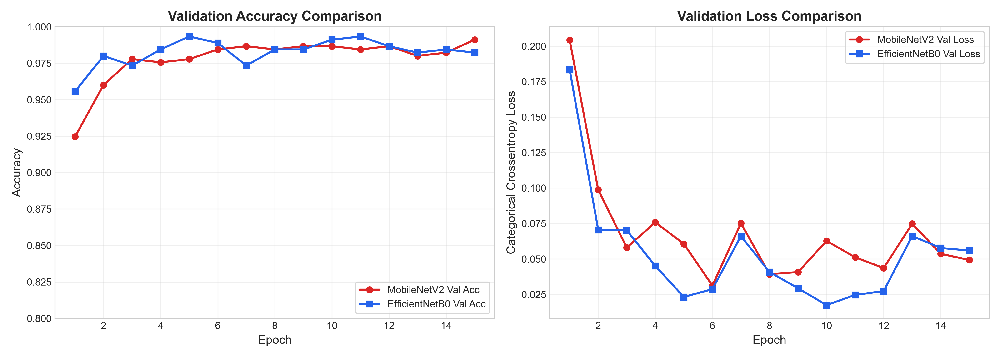
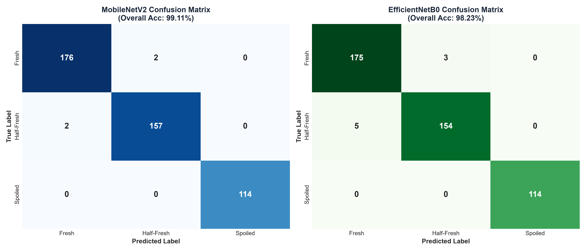
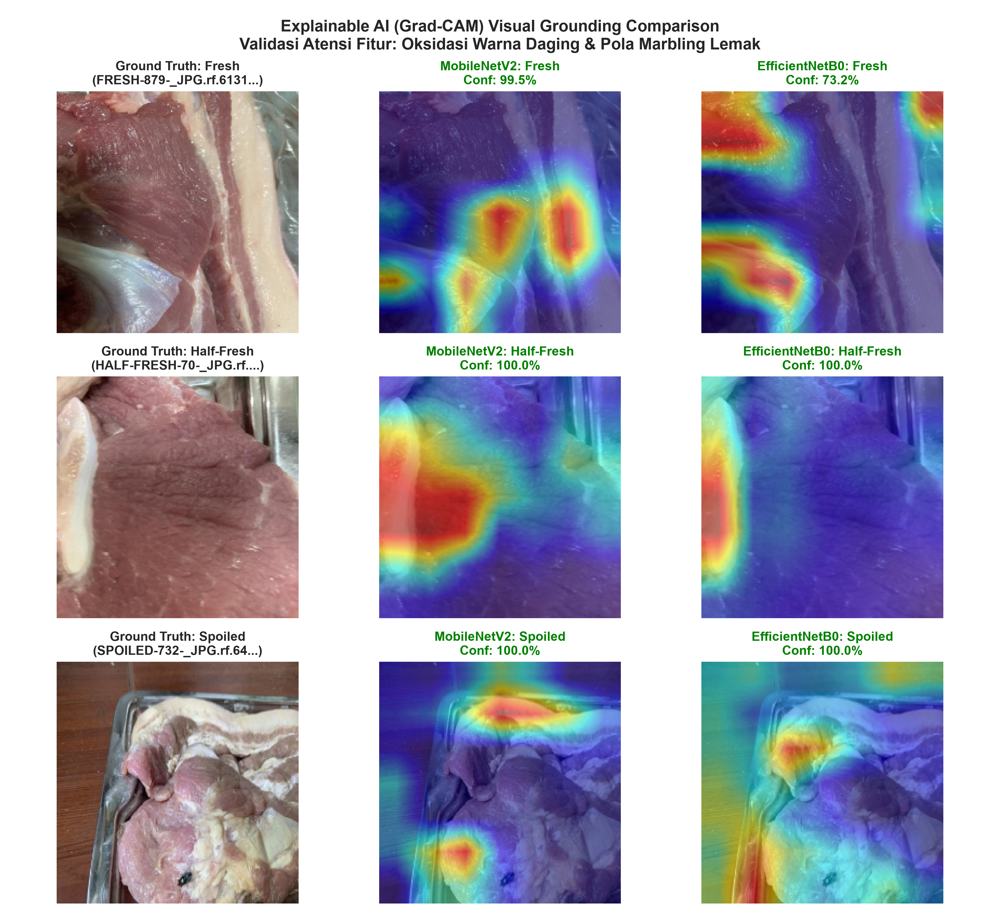

# Analisis Komparatif Arsitektur MobileNetV2 dan EfficientNetB0 dengan Visualisasi Grad-CAM untuk Klasifikasi Mutu Kesegaran Daging

[](https://www.python.org/)
[](https://tensorflow.org/)
[](https://keras.io/)
[](https://www.kaggle.com/datasets/vinayakshanawad/meat-freshness-image-dataset)
[]()
[]()

> **Tugas Besar (Tubes) Mata Kuliah: Visi Komputer (CII3B4)**  
> **Milestone:** Ujian Tengah Semester (UTS) — Progres Pengerjaan Bab 1–3, Implementasi Awal, dan Visual Grounding.

---

## 📌 Ringkasan Proyek

Penelitian ini mengusulkan sistem inspeksi mutu dan kesegaran daging non-destruktif berbasis visi komputer dengan membandingkan dua arsitektur *deep learning* modern berbobot ringan (*lightweight*): **MobileNetV2** dan **EfficientNetB0**. 

Untuk mengatasi keterbatasan riset terdahulu yang memperlakukan CNN murni sebagai *black box*, penelitian ini mengintegrasikan **Explainable AI (Grad-CAM)** guna memvalidasi secara visual bahwa keputusan klasifikasi didasarkan pada degradasi biokimia daging (warna pigmen mioglobin dan tekstur lemak/marbling), bukan artefak latar belakang.

---

## 🔬 Research Gap & Kebaruan (Novelty)

Penelitian ini secara kritis menyelesaikan 4 keterbatasan pada literatur rujukan utama:
1. **Gap Skala Data:** Menggunakan **2.266 citra** (Kaggle Meat Freshness Dataset) beresolusi 416x416 RGB, jauh lebih representatif dibanding riset terdahulu (misal: Anshori et al. hanya 180 citra).
2. **Paradoks Arsitektur:** Menggantikan model raksasa VGG-16 (>138 Juta parameter, >500 MB) dengan arsitektur ringan modern (<5 Juta parameter, ~4.18 MB) yang ramah perangkat *edge/mobile*.
3. **Membuka Black-Box (XAI):** Menerapkan *Gradient-weighted Class Activation Mapping* (Grad-CAM) untuk membuktikan atensi spasial model.
4. **Karakterisasi Fase Transisi:** Menganalisis secara granular fase kritis `Half-Fresh` yang menjadi batas awal pembusukan daging.

---

## 📊 Hasil Awal Implementasi & Benchmark Empiris

Evaluasi dilakukan pada **451 citra validasi independen**:

| Metrik Evaluasi | MobileNetV2 (Winner 🏆) | EfficientNetB0 | Analisis / Keterangan |
| :--- | :---: | :---: | :--- |
| **Akurasi Validasi** | **99.11%** (447/451 benar) | **98.23%** (443/451 benar) | **MobileNetV2 unggul +0.88%** |
| **Macro F1-Score** | **99.21%** | **98.41%** | Performa seimbang di seluruh kelas |
| **Kecepatan Inferensi (CPU)**| **237.8 ms / citra** | **391.2 ms / citra** | **MobileNetV2 39.2% lebih cepat** |
| **Jumlah Parameter Total** | **2.62 Juta parameter** | **4.41 Juta parameter** | **MobileNetV2 40.6% lebih hemat memori** |
| **Ukuran Bobot Model** | **4.18 MB** | **4.18 MB** | Sangat kompak untuk *edge camera / smartphone* |
| **Deteksi Kelas Spoiled** | **100% (114/114)** | **100% (114/114)** | **Zero False Negative (Keamanan pangan terjamin)** |
| **Akurasi Kelas Fresh** | **98.88%** (176/178) | **97.77%** (175/178) | MobileNetV2 hanya salah 2 sampel |
| **Akurasi Kelas Half-Fresh**| **98.74%** (157/159) | **96.86%** (154/159) | MobileNetV2 lebih sensitif pada degradasi awal |

### Kurva Pelatihan & Matriks Konfusi



---

## 🧠 Validasi Visual Explainable AI (Grad-CAM)



* **Fresh:** Atensi terfokus kuat pada jaringan otot merah segar (*oxymyoglobin*) dan lapisan marbling putih bersih.
* **Half-Fresh:** Peta atensi mulai bergeser ke area diskolorasi (merah pudar keabu-abuan).
* **Spoiled:** Heatmap merah mengunci area dekomposisi pigmen kecokelatan/kehijauan (*metmyoglobin*).
* **Bebas Bias:** Area piring, meja, dan pantulan lampu (*specular reflection*) berintensitas nol (biru dingin).

---

## 📁 Struktur Direktori Repositori

```bash
Visi-Komputer-Tubes/
│
├── archive (2)/                       # Dataset Kaggle Meat Freshness (Train & Valid)
│   └── Meat Freshness.v1-new-dataset.multiclass/
│       ├── train/                     # 1.815 citra latih + _classes.csv
│       ├── valid/                     # 451 citra validasi + _classes.csv
│       └── README.dataset.txt
│
├── Presentasi_UTS_Tubes_Visi_Komputer.pptx # Slide presentasi 20 menit (11 Slide 16:9 Widescreen)
├── benchmark_models.py                # Skrip utama pelatihan & komparasi MobileNet vs EfficientNet
├── benchmark_results.json             # Rekap metrik evaluasi kuantitatif lengkap
├── demo_predict.py                    # Skrip live demo inferensi instan + Grad-CAM
├── eda_dataset.py                     # Skrip eksplorasi & verifikasi statistik dataset
├── generate_uts_presentation.py       # Generator otomatis slide PPTX
├── training_curves_comparison.png     # Grafik kurva loss & akurasi
├── confusion_matrices_comparison.png  # Visualisasi confusion matrix
├── gradcam_comparison.png             # Visualisasi Grad-CAM 3 kelas
├── .gitignore                         # Konfigurasi pengecualian file temporary
└── README.md                          # Dokumentasi resmi proyek
```

---

## 🚀 Panduan Menjalankan Program

### 1. Instalasi Dependensi
Pastikan Python 3.10+ telah terinstal, lalu pasang paket pendukung:
```bash
pip install tensorflow keras opencv-python matplotlib seaborn pandas scikit-learn python-pptx
```

### 2. Menjalankan Demo Prediksi & Grad-CAM (Live Demo)
Untuk menguji citra secara acak dari data validasi:
```bash
python demo_predict.py
```
Untuk menguji citra tertentu:
```bash
python demo_predict.py --image "path/ke/citra_daging.jpg"
```

### 3. Menjalankan Ulang Benchmark
Untuk melatih ulang model dan memperbarui seluruh grafik metrik:
```bash
python benchmark_models.py
```

### 4. Menghasilkan Slide Presentasi PowerPoint
Untuk memperbarui slide presentasi UTS:
```bash
python generate_uts_presentation.py
```

---

## 📅 Roadmap Pengerjaan Tubes (Pasca-UTS)

* **Minggu 10–11:** *Fine-Tuning* 20–30 lapisan atas backbone dengan learning rate rendah ($10^{-5}$) dan augmentasi variasi pencahayaan.
* **Minggu 12–13:** Kuantisasi model ke format TensorFlow Lite (INT8 / FP16) untuk kompresi ukuran file ($<2\text{ MB}$) dan uji coba pada smartphone/Raspberry Pi.
* **Minggu 14–15:** Penyusunan laporan akhir (Bab 4 & 5), penyesuaian template paper jurnal ilmiah (Sinta / IEEE), dan persiapan sidang akhir Tubes.

---

## 👥 Tim Penulis
* **Mata Kuliah:** Visi Komputer (CII3B4)
* **Program Studi:** S1 Informatika / Teknik Komputer
* **Dosen Pengampu:** [derekln14](https://calendly.com/derekln14/bimbingan-ta-tzl)
